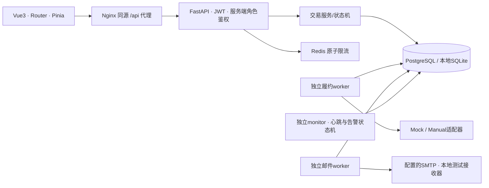
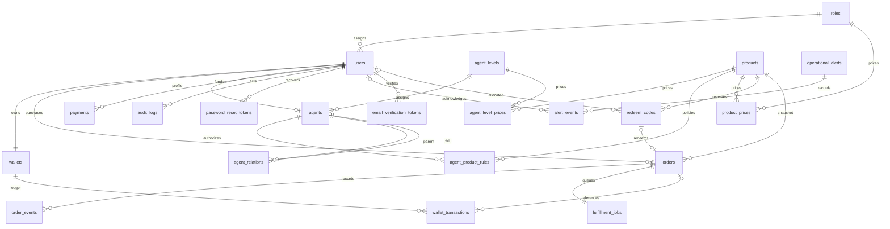

# 技术架构、数据设计与一致性

## 组件

所有价格、库存、钱包和权限判断在后端；前端展示的价格不是扣款依据。API 路由负责输入和授权，services 负责事务内操作，repositories 负责安全查询/分页，models 定义关系约束。每个请求一个 SQLAlchemy Session，成功显式 commit，异常关闭 Session 自动回滚。没有启动时 `create_all`，建表只能通过 Alembic。

SQLite 为本地兼容采用 WAL + 外键 + `BEGIN IMMEDIATE`，请求事务串行，不能替代生产压力测试。PostgreSQL 使用行锁、条件 UPDATE、唯一约束；worker 用 `SKIP LOCKED`，并与管理订单操作保持 job→order 的锁顺序，避免交叉死锁。

## ER 关系

`system_settings` 为独立键值表；多级 `agent_relations` 仅预留结构，不开放写接口，不能认为已实现多级分销。

## 表字段与约束

精确 DDL 见 `backend/alembic/versions/*initial_commerce_schema.py`，ORM 见 `backend/app/models/entities.py`。

| 表 | 关键字段和约束 |
|---|---|
| password_reset_tokens | 随机ID PK、user FK、auth_version、token_hash UNIQUE、expires/used、delivery_status CHECK、attempts 0..3、next_attempt_at、固定last_error、created；投递状态与时间/用户与时间复合索引 |
| email_verification_tokens | 随机ID PK、user FK、auth_version、email_hash、token_hash UNIQUE、expires/used、投递状态和次数约束、重试索引；与重置凭证用途隔离 |
| roles | name varchar(20) PK、label |
| users | int PK、email varchar(254) UNIQUE/统一小写、password_hash、name、role FK、active、token_version、email_verified_at可空、时间戳 |
| products | int PK、name/description/category、original_price/price BIGINT≥0、stock int≥0、active、sort、时间戳 |
| product_prices | int PK、product_id FK、role FK、price BIGINT≥0；UNIQUE(product_id,role) |
| wallets | user_id FK/PK、balance/frozen BIGINT≥0、时间戳 |
| orders | 随机YG编号 PK、nullable user FK、product FK、product_name快照、source CHECK、amount BIGINT≥0、两组状态CHECK、请求键、lookup_hash、原因/完成时间；UNIQUE(user_id,idempotency_key) |
| redeem_codes | int PK、code_hash varchar(64) UNIQUE、suffix、batch_id索引、product/owner FK、status CHECK、expires/used、nullable order FK UNIQUE、request_key |
| wallet_transactions | int PK、wallet FK、amount/frozen_delta BIGINT、变更后双余额≥0、kind、reference UNIQUE、nullable order FK、note、created |
| order_events | int PK、order FK索引、action、nullable actor FK、note、created |
| fulfillment_jobs | int PK、order FK UNIQUE、state索引、attempts CHECK 0..3、last_error、时间戳 |
| agents | user FK/PK、level_id FK及索引、时间戳 |
| agent_relations | int PK、parent/child FK、child UNIQUE、parent!=child CHECK（预留） |
| payments | 随机ID PK、user FK、provider、external_id UNIQUE、amount>0、status、时间戳；目前仅demo |
| audit_logs | int PK、actor FK、action/target/detail、created索引 |
| system_settings | key PK、value；仅开放sales_enabled/redemption_enabled |

复合索引：orders(user_id,created_at)、wallet_transactions(user_id,created_at)。订单履约状态、卡密状态/归属/批次、任务状态均有查询索引。外键默认不级联删除关键账务数据；管理端只停用实体。未来价格改变不会修改订单的金额与商品名称快照。商品编辑必须携带列表返回的expected_updated_at（updated_at原值），版本不匹配返回409，避免旧表单覆盖并发销售扣减的库存。

## 交易不变量

### 钱包购买

1. 按用户和幂等键查询已创建订单；若相同键对应不同商品/来源，409。
2. 检查销售开关并锁商品；读取后端代理价；条件扣库存且保证≥0。
3. 插入 PAID+QUEUED 订单及任务、事件。
4. `UPDATE wallets SET balance=balance-amount WHERE balance>=amount`，返回余额快照并插入唯一 reference 流水。
5. 一次提交；任何失败全部回滚，包括库存、订单、任务和资金。并发相同请求的唯一约束冲突返回409，用原键重试。

### 卡密

密码学安全随机源生成128位随机卡密，HMAC-SHA256加服务器独立pepper存储，原始卡密仅响应一次。数据库/API列表/审计不保存完整卡密。生成时原子预留 quantity 库存。

公开兑换锁卡密，检查可用商品，条件 `UNUSED AND expires_at>now` 原子改 USED，创建订单并绑定。事务回滚时卡密恢复。相同卡密+相同请求键返回原订单，其他键拒绝。过期是由 `UNUSED + expires_at` 派生的展示状态，不依赖后台定时修改状态，边界检查始终在SQL中进行。

公开查询采用高熵随机订单号+查询凭证。凭证由服务器HMAC及客户端随机幂等键推导，数据库只保存凭证哈希；重复兑换仍可返回同一凭证。查询用POST，凭证不会出现在URL日志中。前端仅sessionStorage保存请求随机键及卡密的SHA256索引，不保存完整卡密或查询凭证；请用户下载凭证。

### 账务

`reference` 的数据库唯一约束防重复入账。余额变化和流水在同一事务。冻结：available减n、frozen加n；解冻反向，二者都有流水。管理员操作记录原因与审计。重复幂等请求必须匹配金额/用户/冻结额/类型/原因，否则409。充值同时写payments demo记录。

从0余额初始化；`reconcile` 检查余额=SUM(amount)、冻结=SUM(frozen_delta)。生产支付渠道的真实账单对账尚未接入；此命令仅校验内部总账。

### 状态流转

支付：`PAID → REFUNDED`（仅失败或取消的钱包订单）。

履约：`QUEUED → COMPLETED/FAILED/CANCELED`；预留 PROCESSING 以扩展外部渠道；`FAILED → QUEUED` 需人工审核重试，最多3次执行。已退款不能重试，已完成不能自动退款。退款唯一reference为 `refund:<order_id>`，并锁订单，重复/并发退款不重复入账。卡密订单金额0且无钱包扣款，拒绝钱包退款。

持久化job与订单同事务创建。mock worker在短事务中锁job和订单并完成，没有先发内存消息再提交的丢单窗口；进程在提交前退出，数据库回滚，下一worker可再次领取。manual模式不消费，管理员人工操作同时更新job/order/event/audit。

扩展外部履约必须增加事务外调用、提供方幂等键、outbox/租约/失联恢复、签名回调及查询对账；不能把当前数据库事务直接包住外部网络请求。

## 安全边界

Argon2密码；JWT HS256 固定算法/exp/sub/ver校验；令牌有效期默认60分钟；退出/改密/禁用/角色变更使旧令牌失效。全部受保护API验证服务端角色和数据归属。邮箱登录限流按IP，生产Redis原子计数且故障关闭；本地进程限流只用于开发。

Compose 的API不公开端口，TRUST_PROXY=true仅接受Nginx覆盖的X-Real-IP；如果单独暴露API，必须TRUST_PROXY=false。默认Nginx按即时连接IP限流；多层反代下若需真实访客IP，运维需明确配置可信代理网段，禁止全网信任XFF。

前端不使用v-html展示商品，Vue转义文本；Nginx设置CSP禁止外部脚本与框架嵌套；无第三方字体请求。后端不输出SQL参数；访问日志不记录请求体、Token或卡密。敏感配置通过环境变量和未跟踪的.env注入。

## 邮件找回扩展

详见[密码找回设计与配置](password-recovery.md)。请求只创建持久任务，不在API事务中连接SMTP。账号有效性响应统一202，IP/邮箱共享双限流；重置链接存哈希并绑定token_version，事务内锁账号、原子消费凭证、更新密码和审计，撤销旧会话。独立mail-worker投递同一安全令牌，有限重试，无邮件正文落库。未配置默认关闭；生产启用要求HTTPS和SMTP TLS。

代理配置扩展新增agent_levels/agent_level_prices/agent_product_rules，旧level文本数据回填为等级外键；采购采用确认金额和账号→代理→等级→商品锁序，详见[代理一致性设计](agent-pricing.md)。

邮箱验证复用独立邮件进程，每种邮件在独立事务中消费各自队列。凭证绑定当前邮箱哈希及账号版本；用户锁与一次性条件更新确保只验证一次，写入验证时间和审计。新钱包购买在原订单幂等重放之后、库存与资金变更之前检查可选门槛。详见[验证设计](email-verification.md)。

## 交易报表

`api/reports.py`校验受限日期范围和管理员权限，`services/reports.py`对orders单条聚合SELECT计算各状态计数和金额，返回总计、补零每日与分页商品汇总。三个部分来自同一查询结果，避免并发退款造成一次响应内部不一致。PostgreSQL按UTC转换后分日，不依赖连接时区。金额来自订单快照，不连接商品实时价格；CSV只包含日期、固定枚举、整数和固定TOTAL标记，避免用户文本成为电子表格公式。导出记录审计并按账号每分钟最多5次。详见[报表定义](reports.md)。

## 操作日志筛选与导出

`services/audit_logs.py`提供统一受限筛选和CSV文本处理，`api/audit_logs.py`管理分页/ID上界/10000条上限/导出账号限流及审计提交。页面独立加载，旧列表路径保留；不新增模型、索引或迁移。ID上界约束常规追加下的分页，不保证跨请求MVCC快照，详见[边界与导出约定](audit-logs.md)。

## 运行状态摘要

`services/operations.py`从orders/fulfillment_jobs和两张邮件凭证表聚合只读计数，`api/operations.py`限制管理员权限、阈值和分页。按白名单字段输出异常订单，不暴露任何凭证、连接字符串或原始错误；页面通过原订单管理入口处理，不引入新写状态机。计数与页面规则不是worker心跳，详见[运行状态定义](operations.md)。

## 持久化监控

新增worker_heartbeats（service主键/last_seen_at）、monitor_state（id=1单行、first/last_checked）、operational_alerts（code/scope唯一、状态/级别/数量/轮次约束、首末触发/恢复时间）、alert_events（告警FK、可空actor FK、action/note/时间）。monitor_state行锁串行采样；告警行锁控制确认与恢复，expected_occurrences防旧页面确认新一轮异常。事件与告警同事务，心跳按服务原生upsert，凭据不进入心跳/规则数据。详见[监控状态机](monitoring.md)。
