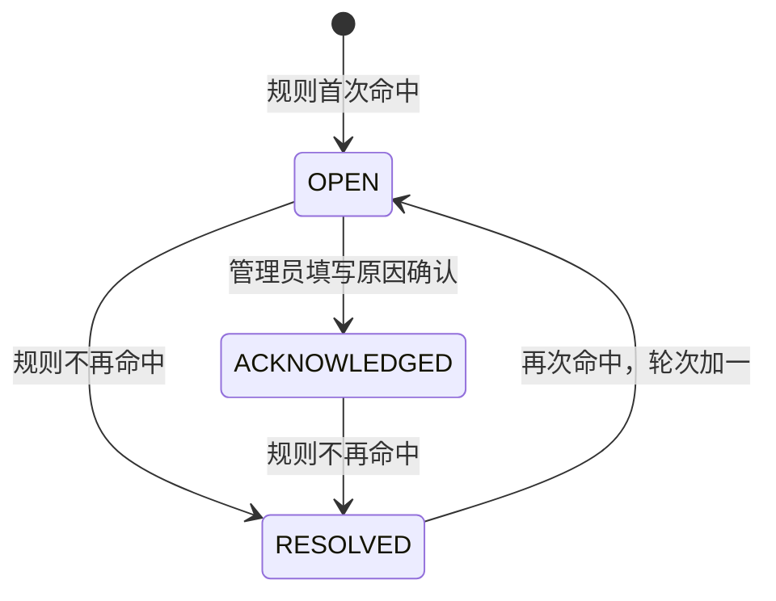

# worker心跳与持久化站内告警

迁移head `32fb2f23c757`增加4张表，共24张业务表：worker_heartbeats按服务记录最近循环完成时间；monitor_state单行保存监控基线与采样时间；operational_alerts按规则/范围唯一保存告警；alert_events追加触发、确认、恢复、再触发记录。

## 启动与配置

```dotenv
MONITOR_ENABLED=true
MONITOR_INTERVAL_SECONDS=15
WORKER_HEARTBEAT_SECONDS=10
WORKER_STALE_SECONDS=60
MONITOR_STALE_MINUTES=30
```

配置API、履约worker、邮件worker、monitor一致。本地先在backend运行`alembic upgrade head`和`python -m app.cli seed`，再分别启动`python -m app.tasks.worker`、`python -m app.tasks.mail_worker`、`python -m app.tasks.monitor`。Compose自动启动monitor，迁移成功后才启动各进程。监控默认启用，不发送外部消息。

心跳间隔5–60秒；失联阈值30–600秒，必须至少为心跳间隔3倍、采样间隔2倍。采样间隔5–300秒；持久告警履约等待阈值1–10080分钟，与运行状态页面临时筛选阈值独立。关闭MONITOR_ENABLED后保留现有告警且暂停采样，页面显示关闭，不把历史状态冒充最新结果。

## 心跳含义

履约与邮件进程每个循环完成后按节流间隔写心跳，空闲、人工模式或邮件关闭时也可报告循环；主进程遇未处理异常退出后停止写入。monitor每次扫描事务提交后报告自身心跳。`--once`也会报告完成；一次性运行后自然会超时，不可将其当长期进程。

表中每类服务只有一条记录，多个副本共享最近一次报告，原生upsert防并发插入冲突且不允许较早时间倒退覆盖。它反映至少有一个实例近期完成循环，不能证明所有副本存活，不输出主机名、PID、数据库地址或SMTP配置。

状态：RECENT近期完成过循环；STALE已收到过但超过阈值；MISSING建立监控基线并经过宽限仍未收到；STARTING基线建立后处于宽限；UNKNOWN尚未建立基线；NOT_REQUIRED当前配置不要求该进程。人工履约模式不要求履约worker；两项邮件功能都关闭时不要求邮件worker；监控关闭时monitor不要求运行。过期边界为超过阈值才超时。

心跳不证明SMTP/外部渠道健康。monitor自己停止后无法继续创建持久告警，但页面直接读取心跳仍可显示其STALE；监控自身异常需外部容器/进程监控覆盖。

## 告警状态机



采样复用运行状态的固定规则：履约超时（人工模式info、模拟warning）、失败/取消待处理、执行耗尽、邮件有效投递失败、功能关闭下的到期待发记录；再增加需要运行的履约/邮件worker心跳超时或缺失。每个规则/范围只保留一条，持续异常更新count/last_seen，不每次采样追加事件或产生新行。恢复时count清零并写resolved_at；再次触发重新打开、occurrences加一，保留事件历史。

monitor先锁monitor_state单行再扫描/锁告警，防多副本产生重复告警或恢复事件；SQLite用BEGIN IMMEDIATE，PostgreSQL行锁。确认锁目标告警，仅OPEN→ACKNOWLEDGED写一条事件和一条审计，重复确认不重复写。确认不修复异常、不退款、不重试、不发送消息。异常持续时已确认状态保持；恢复后又复发仍需确认新轮次。

确认必须提交expected_occurrences；旧页面的轮次不匹配返回409，防止误确认已恢复后重新发生的告警。已恢复返回409，不存在404。原因去首尾空白后3–200字，额外字段拒绝。所有敏感接口后端限定管理员，普通用户/代理403，未登录401。

## API

- GET `/api/admin/operations/monitor`：enabled/采样间隔/持久阈值/首末采样时间/workers。只读，不因访问触发采样。
- GET `/api/admin/operations/alerts`：status=active（默认全部未恢复）/OPEN/ACKNOWLEDGED/RESOLVED，page/page_size，默认20最多100，按最近触发时间与ID降序。
- GET `/api/admin/operations/alerts/{id}/events`：该告警事件分页，按ID降序，含操作人ID/说明/时间，无用户邮箱或凭证。
- POST `/api/admin/operations/alerts/{id}/acknowledge`：`{"note":"已安排核查","expected_occurrences":1}`，返回告警；账号共享每分钟20次，超限429，成功写审计`alerts.acknowledge`。

页面`/admin/monitoring`支持心跳卡片、告警筛选、确认弹窗、事件记录与跳转运行状态。不提供强行关闭、删除告警或修改心跳的HTTP接口。服务数据库不可用沿用503，所有响应no-store。不同读请求不保证同一快照；采样失败整体回滚，不把部分规则静默标记恢复。

## 升级、运维与边界

升级前备份，运行`alembic upgrade head`；4张新表独立于订单/钱包。降级会删除全部心跳/告警/事件记录，必须先停monitor/API/worker且按备份策略执行；不要在生产直接运行迁移往返测试脚本。监控历史没有自动删除策略，按业务保留政策备份归档。

本版本仅**持久化站内告警**，没有外部邮件/短信/Webhook通知、SLO、跨区高可用或不可篡改告警存储。单个monitor故障、数据库故障和全机宕机需要外部监控系统；不宣称站内告警可覆盖自身失效。计数沿用运行状态约定，邮件有效投递失败不额外遍历账号/凭证有效性；人工等待可能是正常业务，不自动加剧为资金故障。

验证覆盖SQLite/PostgreSQL并发心跳、non-regressing timestamp upsert、宽限边界、可选服务、采样去重、确认幂等、恢复/复发、旧轮次拒绝、事件隔离/分页、权限与敏感字段；浏览器实际确认→查看事件→退款后恢复→新异常再次触发。验收记录见verification.md。
